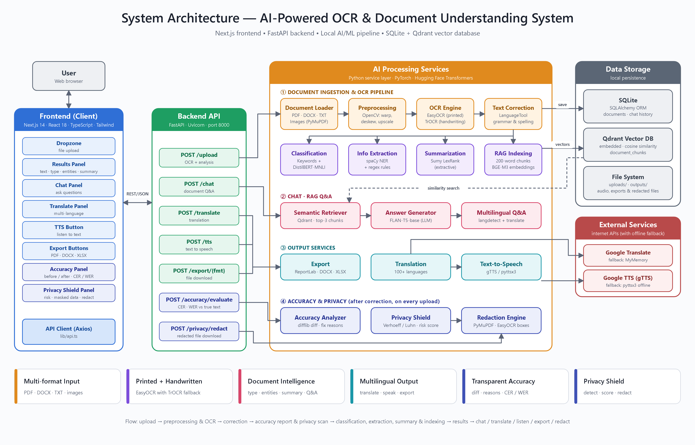

# AI-Powered Intelligent OCR with Document Understanding

A web application that turns scanned, photographed and handwritten documents into accurate, searchable and safely shareable text. Most OCR tools stop at extracting text. This system also corrects the text, works out what kind of document it is, extracts the important fields, summarizes it, answers questions about it, translates it and reads it aloud. Two features go further than general-purpose OCR tools and AI chat assistants:

- **Accuracy Analysis** shows exactly what the correction step changed, why it changed it, and how accurate the OCR is.
- **Privacy Shield** finds personal data such as Aadhaar, PAN and bank details before you share a document, and produces a redacted copy in the original file format.

Mini project — B.Tech CSE (Data Science), Geethanjali College of Engineering and Technology.



## Features

| Feature | What it does |
|---|---|
| Multi-format input | PDF, DOCX, TXT and images (PNG, JPG, WEBP, TIFF, …) |
| Image pre-processing | Page detection, deskew and upscaling with OpenCV |
| Printed + handwritten OCR | EasyOCR for printed text, TrOCR for handwriting; optional Azure AI Vision or Claude vision for better handwriting |
| Error correction | Spelling and grammar correction with LanguageTool; names, IDs and e-mails are protected from being "corrected" |
| Document classification | Invoice, resume, receipt, prescription, ID card, notes, presentation |
| Information extraction | Names, dates, e-mails, phone numbers and amounts (spaCy NER + rules) |
| Summarization | Extractive summary with LexRank |
| Document chatbot | Ask questions about the document (BGE-M3 embeddings + Qdrant + FLAN-T5), in any language |
| Translation and speech | Translate into 100+ languages and listen to the text |
| Export | PDF, Word and Excel |
| **Accuracy Analysis** | Raw vs corrected text side by side, a change log with the reason for every fix, fixes by type, and CER/WER measured against the true text |
| **Privacy Shield** | Detects Aadhaar (Verhoeff checksum), PAN, card numbers (Luhn checksum), bank accounts, IFSC, passport, date of birth, phone, e-mail and names; gives a risk score; downloads a redacted copy as PDF, image, DOCX or TXT with the layout unchanged |

Detection and redaction run entirely on the backend. Nothing is sent to an external service for the privacy check.

## Tech stack

- **Frontend:** Next.js 14, React 18, TypeScript, Tailwind CSS
- **Backend:** Python, FastAPI, SQLAlchemy + SQLite
- **AI/ML:** EasyOCR, TrOCR, LanguageTool, spaCy, DistilBERT-MNLI, Sumy, BGE-M3, Qdrant, FLAN-T5, PyMuPDF, OpenCV
- **Services:** deep-translator (Google Translate), gTTS / pyttsx3

## Project structure

```
backend/
  app/
    main.py              FastAPI app and route registration
    routes/              upload, chat, translate, tts, export, accuracy, privacy
    services/            OCR, correction, classification, extraction, RAG,
                         accuracy_service, privacy_service, redaction_service, ...
  requirements.txt
  .env.example
frontend/
  app/                   Next.js page
  components/            Upload, results tabs, Accuracy and Privacy Shield panels, ...
  lib/                   API client and types
docs/
  system_architecture.png
```

## Setup

### Requirements

- Python 3.10 or newer (developed on 3.11)
- Node.js 18 or newer
- Java 8 or newer (needed by LanguageTool for text correction)
- About 5 GB of free disk space for the AI models, which download automatically the first time they are used

### 1. Backend

```bash
cd backend
python -m venv venv
venv\Scripts\activate            # Windows
# source venv/bin/activate       # macOS / Linux

pip install -r requirements.txt
python -m spacy download en_core_web_sm
python -m nltk.downloader punkt punkt_tab
```

Copy `backend/.env.example` to `backend/.env`. All keys are optional:

- leave them blank to run all OCR locally;
- add `AZURE_VISION_ENDPOINT` / `AZURE_VISION_KEY` or `ANTHROPIC_API_KEY` for faster, more accurate handwriting recognition. Note that this sends images to that cloud service.

Start the API:

```bash
uvicorn app.main:app --host 127.0.0.1 --port 8000
```

The API runs at http://localhost:8000, with interactive docs at http://localhost:8000/docs.

### 2. Frontend

In a second terminal:

```bash
cd frontend
npm install
npm run dev
```

Open http://localhost:3000.

## Usage

1. Drag a document onto the upload panel and click **Upload and Extract**. The first upload is slow while the models load.
2. Use the result tabs: **Extracted Text**, **Corrected Text**, **Structured Info**, **Summary**, **Accuracy** and **Privacy Shield**.
3. In **Accuracy**, review every correction. To measure real accuracy, paste the true text of the document and click **Evaluate** to get CER and WER for the raw and corrected text.
4. In **Privacy Shield**, check the risk level and the detected items, then click **Download redacted … (same layout)** to get a safe-to-share copy.
5. Use the side panels to translate, listen, ask questions or export.

## API endpoints

| Method | Endpoint | Purpose |
|---|---|---|
| POST | `/upload/` | Process a document (OCR, correction, classification, extraction, summary, accuracy report, privacy report, indexing) |
| POST | `/chat/` | Ask a question about an uploaded document |
| POST | `/translate/` | Translate text |
| POST | `/tts/` | Text to speech |
| POST | `/export/{pdf\|docx\|xlsx}` | Export results |
| POST | `/accuracy/evaluate` | CER / WER of raw and corrected text against the true text |
| POST | `/privacy/redact` | Redacted copy of the uploaded file in its original format |

## Accuracy metrics

When the true text is supplied, the system computes:

- **CER** (Character Error Rate) = (S + D + I) / N over characters
- **WER** (Word Error Rate) = (S + D + I) / N over words

S, D and I are the substitutions, deletions and insertions needed to turn the OCR output into the true text, and N is the length of the true text. In a test document containing typical OCR errors, correction reduced WER from 25% to 0% and CER from 10.75% to 0%.

## Limitations

- Correction can change technical names that are not in the dictionary (for example "CloudStack"). The Accuracy change log makes these visible so they can be spotted.
- Results depend on image quality, especially for handwriting.
- Name detection can flag words that are not names, so review the Privacy Shield list before sharing.
- Translation and gTTS need an internet connection.

## Team

- A. Veena (23R11A6799)
- B. Mahesh (23R11A67A5)
- B. Srinidhi Vigneshwari (23R11A67A6)

Guide: Mrs. S. Swapna, Assistant Professor, Department of CSE (Data Science), Geethanjali College of Engineering and Technology.
